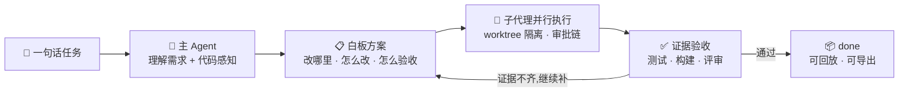

<div align="center">
  
  <h1>LampGenie</h1>
  <p><b>神灯 · 本地优先的开源 AI Agent 运行时与工作台</b></p>
  <p>把一句自然语言愿望,跑成「代码感知 → 白板规划 → 子代理执行 → 证据验收」的可观测、可回放、可审计的交付流水线。</p>
  <p><i>The genie in your lamp — a local-first, open-source agent runtime that turns one wish into a shipped, verified task.</i></p>
  <p>
    <a href="./LICENSE"></a>
    = 20">
    
    
  </p>
</div>

> 🚧 **项目仍在积极开发中**:核心链路已经能完整跑通日常任务,但 bug 还不少,体验也还有毛糙的地方。项目在持续迭代优化中——遇到问题欢迎提 [Issue](https://github.com/Z-yq/lampgenie-harness/issues)。

---

## 一句话说清楚

你在网页面板里打一句:

> 「给用户管理页加一个导出 CSV 的按钮」

LampGenie 不会直接糊一段代码让你自己试。它像一支小型工程团队那样交付:

1. **读懂你的代码库** —— 静态分析出调用图和影响面,知道这个按钮该加在哪个组件、牵动哪些下游;
2. **先给方案再动手** —— 在白板上画出「变更契约图」:改哪个文件、怎么改、怎么验收,一目了然;
3. **派子代理并行实现** —— 实现活进独立 git worktree,互不踩文件;重活需审批,超时会被收割;
4. **证据达标才算完成** —— 跑测试、typecheck、代码评审,证据回填白板;P0 验收不通过,任务不会标 `done`;
5. **全程留痕可回放** —— 每次模型调用、每条命令、每步子代理轨迹都落本地 journal,面板里随时回放复盘。

模型随便换:任何 OpenAI 兼容端点都行,主对话/任务书/评审/语音还能分别配不同模型。代码和密钥全程不出你的电脑。



## 五件别家 harness 少有的能力

hermes、deepseek-harness 这类 harness 都能「接任务、改代码」。LampGenie 的差异在这五件事上:

### 📋 白板规划 —— 过程是画出来的,不是黑盒

任务开工前,主 agent 在白板上画出本次任务的「变更契约图」:现状层与变更层分开,每个节点带目标、验收条件与证据位。13 种任务板型覆盖代码/测试/重构/UI/数据/契约/部署/评审,画布与经典双视图,P0 节点证据不齐**永远不标 done**——流程可解释、可过目、可回溯,而不是日志里翻黑盒。

### 🔄 RSI —— 会自我进化的 harness(递归自我改进)

夜间 **Dreaming 轮**增量拉取自己的 journal 轨迹 → 去噪 → 挖掘薄弱点 → 排队候选实验;每个自我修改提案必须过**六件套安全门**(证据 + 影响面 + dry-run + canary + 回滚点 + owner),再经**注入防护**(来源拉黑/人工批准)、**成本 ROI 门**与**熔断器**(人工暂停/基准快照/回滚计划)层层把关。本仓自身的大量迭代就是由这套机制排队完成的——它改的是自己的代码。运维 CLI 见 `scripts/`(nightly / rsi-weekly / rsi-cost-roi / rsi-injection-guard / rsi-breaker / self-modification)。

### 🎛️ Super Agent 指挥台 —— 动口不动手的老板模式

按天滚动的指挥台会话:SOUL 记忆 + 全局状态摘要每轮重组;调度六件套与任务全生命周期工具(状态/取消/改派/续跑/回溯);**动手永远派给 coding 轨**,自己只管指挥;任务状态自动播报,coding agent 的提问经指挥台转述回你。支持语音输入(ASR→文本)与 IM 入站。

### ✂️ 截图标注 —— 看得见的问题,圈出来就是任务

取屏画框 → 编号批注 → 结构化反馈直接进任务上下文。编辑器支持缩放、撤销、多批注与坐标换算,反馈以 JSON + 预览图落盘并投递给 agent——「这个按钮放错了」这种说不清的问题,圈一下就够。

### 💰 Token 剪枝 —— 长任务不爆预算

自动压实(auto-compact)+ 微压缩 + journal 保留策略 + 注入预算层层配合,小时级长任务持续把上下文剪进预算;配合进程级 AIMD 并发治理(429 自适应退避),多任务并发也不被限流打崩。

## 功能全景

| 域 | 能力 |
|---|---|
| **任务运行时** | 双调度器(user/system)+ 每 owner 串行 + 幂等去重;定时任务与硬超时看门狗;进程级 AIMD 并发治理(429 自适应退避);重试/冷却/恢复 |
| **代码感知** | 调用图与影响面、决策点扫描、HTTP/状态机/算法画像、整仓 code flow、函数级 CFG 控制流图、语义级代码档案(wiki)与功能拆解 |
| **白板** | 十三种任务板型(代码/测试/重构/UI/数据/契约/部署/评审…)、变更契约校验、P0 验收与证据回填、画布/经典双视图 |
| **子代理** | 角色白名单(含 planner/explore/judge)、能力继承、审批链(重活回询主 agent)、worktree 隔离、deadline 收割 |
| **RSI 自我改进** | 夜间 Dreaming 挖掘 → 候选实验排队 → 自我修改六件套安全门(证据/影响面/dry-run/canary/回滚/owner)→ 注入防护 + 成本 ROI 门 + 熔断器 |
| **面板** | 浏览器单页 + Electron 桌面壳;任务流/会话/画布/轨迹回看/模型热切换/截图标注(取屏画框→批注→结构化反馈) |
| **多模型** | OpenAI 兼容端点、按角色配模型(主对话/任务书/评审/语音)、热切换、失败降级与恢复态 |
| **语音与多模态** | 聊天窗录音→任务书、语音任务书模型可配、图片附件识别 |
| **交付物** | 会话导出(journal 全量+轨迹)、评审 PPT(源稿质量门+溢出/重叠 QA+视觉验收)、代码档案站点 |
| **安全** | 出站文本脱敏、权限规则(allow/deny/ask + 通配符)、工具结果审计、journal 幂等与崩溃恢复 |

## 快速开始

要求:Node.js ≥ 20、pnpm。

```bash
git clone https://github.com/Z-yq/lampgenie-harness.git
cd lampgenie-harness
pnpm install
pnpm -r build
pnpm --filter @lampgenie/gateway start   # 打开 http://localhost:7700
```

首次打开面板 → 「设置」页接入模型:任一 OpenAI 兼容端点(填 BaseURL + API Key)。密钥只落本地 `.genie/secrets.json`,不入库、不回显。

> **桌面版**:`apps/desktop` 为 Electron 壳(内置网关托管、无边框标题栏、系统托盘)。构建安装包见 `apps/desktop/README.md`。

### 日常入口

- 面板聊天窗直接提任务(支持 `@文件` 引用、图片附件、✂ 截图标注);
- Super Agent 指挥台:按天滚动的老板会话,动手永远派给 coding 轨;
- 定时任务在任务面板配置(支持超时预算与看门狗);
- 会话回放与导出:会话详情 → 轨迹/导出;
- RSI 运维:`scripts/` 提供 nightly 挖掘 / 周报 / 成本 ROI 门 / 注入防护 / 熔断器的 CLI。

## 配置速查

| 文件/环境变量 | 作用 | 入库? |
|---|---|---|
| `genie.config.json` | 并发上限、权限、面板、任务等非密配置 | 模板 `genie.config.example.json` 入库 |
| `.genie/secrets.json` | 模型 API Key 等凭证 | ❌ 永不入库 |
| `.genie/permissions.json` | 工具/路径权限规则(allow/deny/ask) | 按需 |
| `GENIE_PANEL_READONLY=1` | 面板只读模式 | — |

完整配置项见 `genie.config.example.json` 内注释。

## 架构

| 模块 | 职责 |
|---|---|
| `apps/gateway` | 本地网关:HTTP/WS 面板、任务调度、子代理编排、LLM 热切换、语音/标注通道 |
| `packages/harness-runtime` | agent 主循环、工具调用、上下文压缩、子代理运行时、任务系统 |
| `packages/code-sense` | 静态代码感知:调用图/影响面/画像/评审/代码档案;`code-sense-cli` 是其 CLI |
| `packages/core` | 任务模型、配置分层、journal、权限与审计 |
| `packages/protocol` | 面板与网关的 WS 协议与类型 |
| `packages/harness-*` | 终端、LSP、记忆、经验、执行器、工作流等能力包 |
| `apps/desktop` | Electron 桌面壳(内置网关托管) |
| `packages/test-support` | 测试用脚本化 mock LLM 服务 |

依赖链:`core → harness-runtime → protocol → 其余包 → gateway`。

## 开发者指南

```bash
pnpm -r build        # 按依赖链全量构建
pnpm -r typecheck    # 全仓类型检查
pnpm -r test         # 全仓测试(vitest)
pnpm gate:creds      # 凭证红线扫描(提交前建议跑一次)
```

- 测试约定:`packages/*/test` 与 `apps/*/test`;端到端用例不依赖真实模型(`packages/test-support` 提供 mock LLM);
- 提交建议按主题分批,凭证/运行时产物不入库;详见 [CONTRIBUTING.md](./CONTRIBUTING.md)。

## 安全与隐私

- **本地优先**:网关、面板、journal、密钥都在本机;产品本体不外联(模型端点由你自己配置);
- **凭证隔离**:`.env` / secrets 均被 gitignore;面板错误信息对密钥做脱敏显示,LLM 轨迹落盘前过出站脱敏器;
- **权限闸**:工具与路径按 `allow/deny/ask` 规则求值,重操作走审批链;
- **可审计**:journal 追加式、崩溃可重放,谁在什么时候用了哪个工具、发了什么请求全程留痕。

## 兼容性

Windows(实机)与 Linux/WSL 上开发经验证;macOS 理论可运行但未验证,欢迎反馈。

## 致谢

本项目的设计在演进中参考过若干开源项目的思路(qwen-audio-agent、ZCode、deepseek-harness、opencode、teamai-cli、EditHere、open-code-review、gitdiagram、code2flow、deepwiki-open 等)——**均只作思路致谢,仓库不含任何第三方项目源码拷贝,也不随包分发第三方组件**:面板编辑器、图渲染器、token 估算器等均为本仓自有实现。完整致谢见 [NOTICE.md](./NOTICE.md)。

> 名称说明:LampGenie(神灯里的灯神)与 Cisco pyATS「Genie harness」、Databricks「Genie」等均无关联。

## 许可证

[MIT](./LICENSE) © 2026 LampGenie contributors
