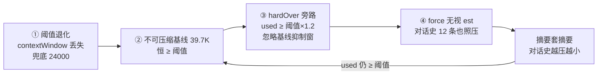

# 一次压缩死亡螺旋事故的完整复盘

> 受众:lampgenie-harness 团队工程师。主题:2026-11-04 web-1793696471953 会话的连环自动压缩事故,为什么四个看起来各自合理的机制叠在一起会变成灾难,以及怎么修。重点只有一条:**压缩动作必须先证明「还有可压缩的东西」,否则它不是降上下文,是销毁对话史**。本文不讲 microcompact 策略细节,不讲 2026-11-03 token 优化的整体盘子。

## TL;DR

11-04 下午,会话 web-1793696471953 在 44 分钟内被自动压缩钩子连环强压 50+ 次:每次压完对话史只剩 12~14 条消息,下一步 `used` 依旧超阈,再压一次——摘要套摘要,直到原始用户提问在模型上下文里彻底消失,当天网关三次 OOM(复盘口径,journal 未留 OOM 事件)。根因是四个环节首尾相接:阈值在运行时退化到 24000、hardOver 强压旁路放行、不可压缩基线高于阈值、force 路径无视对话史估算。修复三件套:floor 护栏、force-vs-est 守卫、threshold 自报。回归测试 34/34 通过(事故当轮口径 32/32),同类螺旋形态已有用例钉死。

## 一、事故现象:44 分钟,50+ 次压缩,journal 里全是实锤

以下数字全部来自 `.genie/journals/sessions/web-1793696471953.jsonl`(15468 行,18.4MB),可复算:

- 全天 `compact.start` 61 次、`compact.done` 60 次,其中 **58 次满足「消息数 ≤20 且估算 <30K」的螺旋形态**。两次正常压缩(13:57 压 523 条/118K、16:01 压 556 条/146K)之后,螺旋从 16:02:09 开始。
- 螺旋段(16:02:09–16:44:51)每次 `compact.start` 的 payload:tokens 6340~17070、messages 12~14 条。也就是说,压的对象是一段 **12 条消息、约 1 万 token 的对话史**。
- `compact.done` 显示被摘要的 head 在中段只剩 **2~3 条**(headCount=3、headCount=2 反复出现),而摘要本身 8.5K~17.9K 字符。第 N 次压缩的输入,是第 N-1 次压缩的摘要——摘要套摘要。
- 模型真实水位(16:02–16:50 窗口 50 个 `message.agent.usage` 样本):inputTokens 31715~54958,**中位 39755**。用户口径「38.5K 上下文被反复强压」与实测中位一致。
- 这 44 分钟向 journal 写入 4.4MB(全文件的 24%),大头是 60 条 `compact.done`(共 3.0MB,单条平均 50KB:摘要+tail+facts 台账)。网关当晚三次 OOM(复盘口径——gateway.jsonl 无 OOM 事件留痕,OOM 属于事后复盘记录;journal 内可核验的是同一时段 MB 级 journal 的持续重写)。
- 原始用户消息共 81 条,journal 里原文都在;但对模型而言,上下文里的对话史被压到 12 条、head 2 条,**第一屏的原始需求在压缩后不可见**——这是「原始用户消息丢失」的确切含义:丢的是模型侧,不是磁盘侧。

## 二、根因链:四个环节,每个都「合理」,接起来就是螺旋

**① 阈值在运行时退化到 24000。** 阈值优先序本是:模型声明 contextWindow → 窗口口径(`窗口−输出预留−buffer`);未声明 → 显式 `compactThresholdTokens` 兜底(`apps/gateway/src/compact-gate.ts:10-12`)。事故会话走的是 session-worker 路径,contextWindow 未透传,于是退化到兜底阈值。修复后加的启动日志原话就是证据——`session-worker.ts:148-149`:「contextWindow 在此丢失会退化到 compactThresholdTokens 兜底(**实测 24000**)」。压缩后水位回到多少才算「压到阈值以下」,这把尺子本身就已经小于基线。

**② 不可压缩基线高于阈值。** `used`(usage.inputTokens 实测)中位 39.7K,包含系统提示、注入块、共享同一 journal 的子代理用量(该文件 `subagent.event` 有 8869 条/6.0MB)。这部分在请求里,但**不在可压缩的对话史里**。阈值 24000 < 基线 39.7K,意味着 `used ≥ 阈值` 是恒真条件,与对话史多大多小无关。

**③ hardOver 强压旁路。** 2026-11-03 引入的合理机制(`compact-gate.ts:188`):`used ≥ scaledThreshold × 1.2` 时忽略基线抑制窗强制压一次,本意是救「单步工具结果把 used 从 18 万推到 25 万」的真实增长。但基线抑制窗(`BASELINE_QUIET_MSGS=2`)原本是防螺旋的唯一护栏,hardOver 把它对 ②场景的拦截整个绕开了。

**④ force 无视对话史估算。** autoCompact 内部本有一道 est 二次闸(`packages/harness-runtime/src/agent/auto-compact.ts:132`):`if (tokens < opts.thresholdTokens && !opts.force)`——est 低于阈值就不压。但 gate 走 hardOver 时 force=true,这道闸被整个跳过。于是出现最荒诞的一帧:**对话史估算 1 万 token、阈值 2.4 万,压缩照样执行**。

四环的合力:②让触发恒真,③解除防重复,④解除「有没有东西可压」的判断,①提供了错误的尺子。每一环单独看都有正当理由,组合起来就是:每一步都把上一轮摘要再摘要一遍,每一步都烧一次摘要调用,对话史单调缩小而 used 纹丝不动。

## 三、为什么三个既有护栏全没拦住

不是没有护栏,是护栏都没有「防旁路证明」。est 闸防的是正常触发路径,没考虑 force;基线抑制窗防的是「刚压完就超」,没考虑 hardOver;hardOver 防的是「涨得太多」,判定依据却只有 used 一个数——而 used 恰恰分不清「对话史涨了」和「基线本来就高」。**单点护栏在引入旁路时没有重新验证「旁路会不会穿透自己」,是这次事故的机制性教训。**

## 四、修复设计:三件套,分别在判定侧、执行侧、观测侧

**floor 护栏(判定侧,`compact-gate.ts:189-195`)。** gate 新增 `floorUsed`:压缩边界后的首个实测水位。`floor ≥ scaledThreshold` 即 floorStuck——它证明「上次压缩根本没把水位压到阈值之下」,超阈部分在不可压缩基线里。此时 hardOver 旁路失效(`!(hardOver && !floorStuck)`),按基线抑制处理:`fire=false, baseline=true`。hardOver 从此只救一种情况:floor < 阈值,即上次压缩确实有效、水位是后来真实涨上去的。

**force-vs-est 守卫(执行侧,`auto-compact.ts:143-148`)。** 即使 gate 放行,autoCompact 内部再拦一道:`trigger=auto && force && 对话史估算 < thresholdTokens` → 拒压,落 `compact.skipped` 事件,`guard="force-vs-est"`,带 tokens 与 thresholdTokens 原值;阈值 ≤32000 时附加提示「检查模型 contextWindow 声明与 compactThresholdTokens 配置」——把阈值退化这类配置问题直接暴露在事件流里。手动 `/compact`(trigger=manual)不受限,用户显式指令仍然最高优先。

**threshold 自报(观测侧)。** `compact.start` payload 增加 `threshold` 字段(`auto-compact.ts:179-180`),每次压缩自证判定阈值;session-worker 启动时打印「压缩口径: spec.contextWindow=… 生效=…」(`session-worker.ts:148-149`)。事故当晚复盘时,60 次强压用的阈值是多少只能靠反推——这两处补上后,同类问题一眼可见。

## 五、验证数据

- **回归测试**:本次复跑四份压缩相关测试全绿 34/34(事故修复当轮口径 32/32;差值为后续新增用例):`compact-gate.test.ts` 15、`compact-hook.test.ts` 3、`auto-compact.test.ts` 14、`auto-compact-model.test.ts` 2。两条钉死螺旋形态的关键用例直接采用事故实锤数据:`compact-gate.test.ts:118`「刚压完就 ≥ 阈值(压不动)即使涨到 1.2×也不许强压」,用例输入 floor=31715 ≥ 阈 24000——正是事故会话 16:02:09 的第一个实测水位;`auto-compact.test.ts:305`「auto 强压 + est < 阈值:拒压,落 compact.skipped 带 guard 标记」。
- **重启后效果**(修复会话验证记录,复盘口径):session.status 回包体积从 MB 级降到 8580B;trace-stats 慢行从几十条降到 1 条。journal 中无 session.status 事件留痕(该帧为 WS 回拉、不落盘),故标注为复盘口径;可核验的对应事实是:修复后新会话不再出现 `messages ≤20 且 trigger=auto` 的 compact.done 序列。

## 六、教训

1. **压缩前先证明可压缩性。** 「水位超阈」只说明请求大,不说明对话史大。floor 证明「上次压有效」、est 证明「这次有东西可压」,两证齐备才动手。缺任何一证,压缩都是负收益:烧摘要调用,还销毁上下文。
2. **判定阈值必须自证留痕。** 阈值是所有压缩决策的隐含分母,它错了后面全错。threshold 进事件、口径进启动日志,事后不需要考古。
3. **加旁路时给每个既有护栏做穿透测试。** hardOver 上线时,基线抑制窗和 est 闸都还「存在」,只是被绕过——用例只测了旁路自己的正路径,没测「旁路 × 既有护栏」的组合。这次的 floor 用例就是补的组合测试。
4. **journal 是事故的唯一真源。** 60 次强压的 tokens/messages/headCount 全部可从 `compact.start/done` payload 复算,复盘没有依赖任何人的记忆;反过来说,没落盘的东西(如 OOM、session.status 回包)就只能标复盘口径——观测覆盖到哪里,结论的可信度就到哪里。

## 证据索引

- 会话 journal:`.genie/journals/sessions/web-1793696471953.jsonl`(61 start / 60 done / 58 螺旋形态;16:02–16:50 inputTokens 中位 39755)
- 判定侧修复:`apps/gateway/src/compact-gate.ts:97-104`(floor 护栏注释)、`:189-195`(floorStuck 判定)
- 执行侧修复:`packages/harness-runtime/src/agent/auto-compact.ts:138-148`(force-vs-est 守卫)
- 观测侧修复:`auto-compact.ts:177-180`(threshold 自报)、`apps/gateway/src/session-worker.ts:148-149`(启动口径日志)
- 回归用例:`apps/gateway/test/compact-gate.test.ts:118`、`packages/harness-runtime/test/auto-compact.test.ts:301-316`
