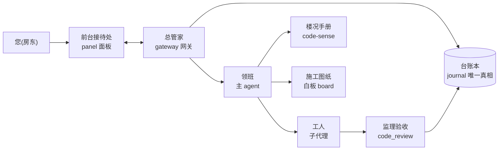
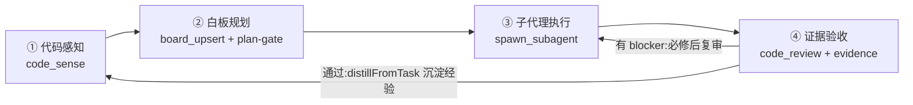
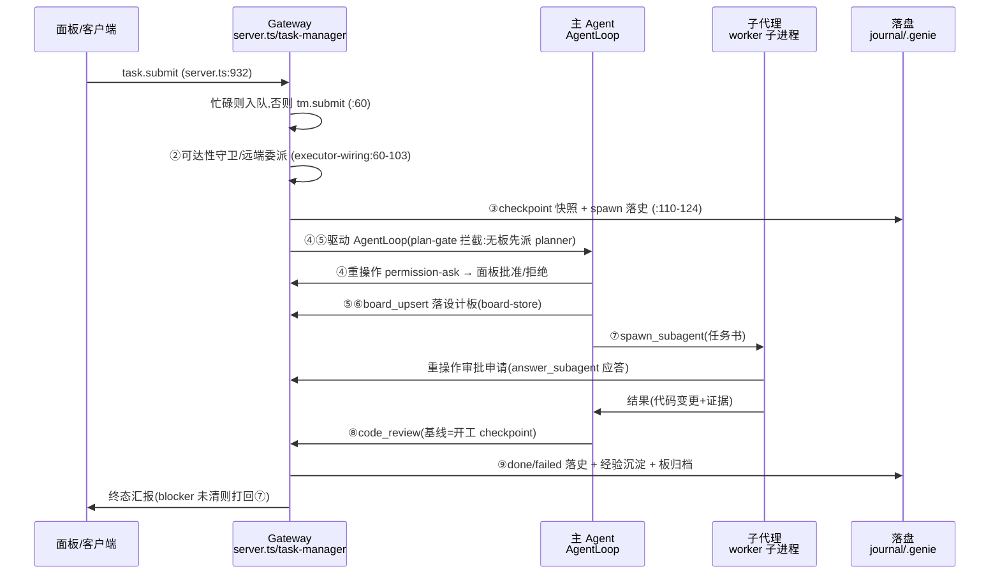
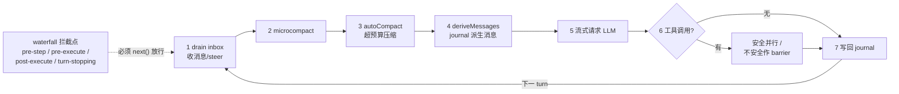
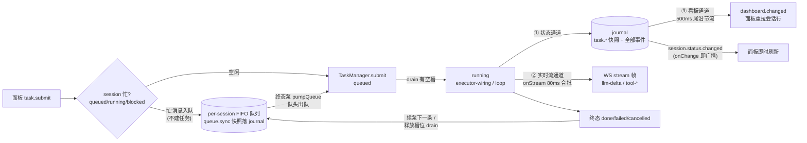
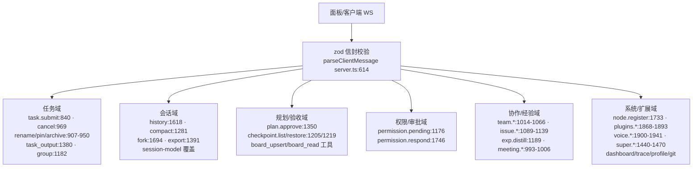
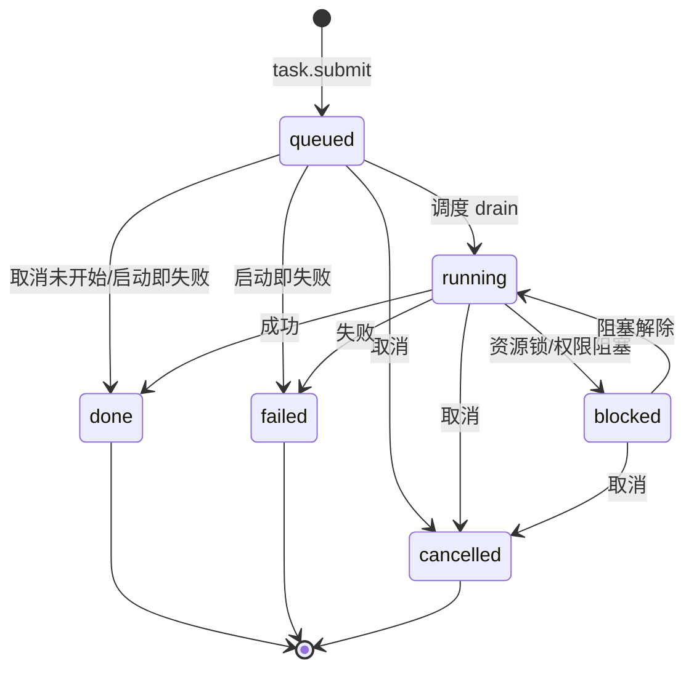
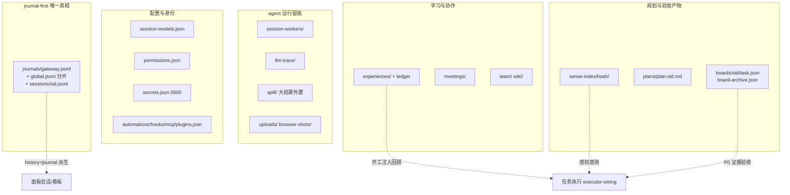
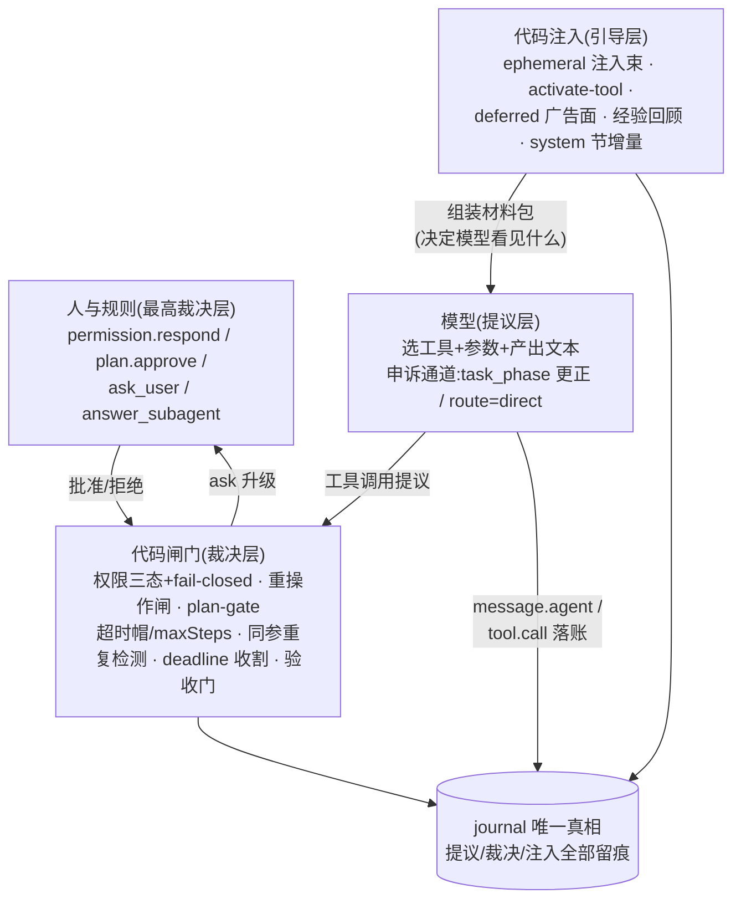

# lampgenie-harness 模块与流水线说明

> **怎么读这份文档**:第一部分是纯大白话——零基础也能读懂这套系统是什么、怎么转,全部用「装修公司」打比方;第二、三部分是同一套东西的技术细节(带 `文件:行号`),给要改代码、排障的人用。两部分讲的是同一个系统,先读第一部分,第二、三部分就不再是天书。
> 基于代码实勘整理(2026-11-02 实勘,2026-11-03 补大白话层与部分行号复核)。文中 `文件:行号` 为当日快照,代码演进后会漂移,以 grep 复核为准。

---

# 第一部分 大白话:这套系统是什么,怎么转

## 1.1 一句话版本

您家里住进了一支「AI 工程队」:您在网页上说一句需求(比如「帮我把这个页面的按钮改成红色」),队伍里有管家接单、领班画图、工人干活、监理验收,活干完了拿证据来交差。这支队伍专门**翻新「代码」这种房子**,也顺手能做 PPT、查资料、整理文档。

它就跑在您自己的电脑上:打开浏览器访问本地端口(默认 `http://localhost:7700`,桌面 App 是 7701)就能用,不连外网也能跑(除了需要大模型「大脑」的时候)。

这就是 lampgenie-harness——README 里那句「个人 AI 数字人管家与 vibe coding agent 的本地运行时」,翻译成人话就是:**一支住在本机、把一句自然语言变成可靠交付物的 AI 工程队**。

## 1.2 全景比喻:一家装修公司

系统里的每个部件,都对应装修公司里的一个角色:

| 装修公司里的角色 | 系统里的真名 | 一句话职责 |
|---|---|---|
| 您(房东) | 用户 | 提需求、批钥匙、看验收单,其余不用管 |
| 前台接待处 | **面板**(panel,网页/桌面 App) | 唯一窗口:说话、看进度、看图纸、验收 |
| 总管家 | **gateway**(网关,核心进程) | 接单、排班、记账、传话;自己不动手改东西 |
| 台账本 | **journal**(`.genie/journals/*.jsonl`) | 只加页、不撕页的总账,全系统唯一的「真相」 |
| 外聘大脑顾问 | **LLM**(大模型,比如各种 GPT/通义类模型) | 只负责「想」,不负责「记」;每次都要把材料包递给它 |
| 领班师傅 | **主 agent**(agent loop) | 翻手册、画图纸、派活、盯验收,全程主导 |
| 楼况手册/探测仪 | **code-sense**(代码感知) | 毫秒级查清「这面墙是不是承重墙、水电线怎么走」 |
| 施工图纸+验收单 | **白板**(board) | 先画图后动工;关键项必须写明「怎么算合格」 |
| 开工许可证 | **plan-gate** | 没有图纸,不准动工(硬规矩,不是建议) |
| 干活工人 | **子代理**(subagent) | 拿着任务书进屋干活,各占各的工位互不踩脚 |
| 保险柜钥匙制度 | **权限审批**(permission) | 动大件先找您拿钥匙;没人批=不动手 |
| 动工前拍照存档 | **checkpoint**(检查点) | 开工前快照;改砸了一句话恢复原样 |
| 监理验收员 | **code_review** + **证据**(evidence) | 拿开工前照片逐行对比,不合格打回重做 |
| 完工笔记 | **经验沉淀**(experience) | 每单完工写总结;下次接相似的活先翻旧笔记 |

**图 0|一单活的全景**(角色怎么连起来;「重活全在工人,管家只传话」):



## 1.3 一单活的完整旅程(跟着走一遍)

以「帮我把这个页面的按钮改成红色」为例,从您开口到交工,一共 12 步。每步括号里是它在系统里的真名,第二、三部分会展开。

1. **您开口提需求**(提交任务):在面板聊天框说出需求。面板把话传给总管家,这一下叫 `task.submit`。您的原话和之后每个动作都会写进台账。
2. **总管登记排队**(任务队列):总管先看这个会话有没有正在干的活——忙不过来就把新需求**挂号排队**,空了再叫号开工。
3. **决定在哪儿干**(本机/远程节点):这活如果需要特殊机器(比如必须 Windows 环境),总管派给联网登记过的远程节点(`node-agent`);否则就在本机开干。
4. **动工前先拍照**(checkpoint):开工前把项目现状拍一张快照存进台账。将来改砸了,一句 `/rewind` 就能整屋恢复原样。
5. **领班接单,先翻手册**(code-sense 代码感知):领班不上来就砸墙。他先查「楼况手册」:这个按钮的代码**被多少地方引用**(承重墙不能乱拆)?数据怎么流(水电线走向)?这些都是查预先建好的索引,毫秒级出结果——**先感知再动手,不做局部盲修**,是这家公司的第一军规。
6. **画图纸**(白板规划 board):像样的活必须先画施工图纸:哪面墙要动、动成什么样、**怎么算合格**(验收标准)。活越大越必须画;**没有图纸,开工许可闸(plan-gate)不放行**。图纸上「本轮必动」的项标成 P0,每项都要写验收方式。
7. **派工人干活**(子代理执行):领班把任务书写给具体工人(子代理),工人带着自己的工具进屋干活,各自有工位、互不踩文件。工人自己也是「小号领班」——同样有手册可翻、有闸门要过。
8. **您批钥匙**(权限审批 permission):工人想动大件(装依赖、删目录、跑全量测试、推网络请求)必须先申请钥匙。面板弹出「工人想装 XXX,准吗?」您点批准或拒绝。**您不在场且没有事先批准规则时,默认拒绝**——宁可不做,不可乱做(fail-closed)。
9. **监理验收**(code_review 代码评审):干完活,监理拿「开工前照片」当基线,逐行对比实际改动,分三档记问题:**blocker**(必须修)、**warning**(建议修)、**nit**(小瑕疵)。有 blocker 打回重做,修完复审。
10. **验收单签字**(证据回填 evidence):图纸上每个 P0 项都要贴上验收证据(测试输出、截图、命令结果),全部签完字这个任务才准标「完工」(done)——**口头说完成了不算**。
11. **交工结算**(任务收尾):领班给您一份人话汇报;台账记下终态;图纸归档保存。
12. **写完工笔记**(经验沉淀 experience):系统自动把「这单学到了什么」提炼进经验库。下次接相似的活,**开工前自动翻旧笔记**垫在领班脑子里——队伍越用越熟练。

## 1.4 三个「为什么」(设计思想的根)

**为什么凡事都要记账(journal-first)?**
三个原因。①外聘的大脑顾问(LLM)**没有记性**——它每回答一轮就忘了上一轮,领班每次都得「从台账整理出材料包」重新递给它(这个动作叫 deriveMessages),台账是唯一真相。②**崩溃可恢复**:电脑重启后,队伍靠重放台账把没干完的活接着干。③**全程可回放**:哪个时间点谁改了什么、大脑顾问当时想了什么,台账和轨迹(llm-trace)里全有,事后能对账、能审计、能复盘。

**为什么要先画图纸再动工(白板 + plan-gate)?**
AI 大脑拿着真机器,最大的风险是「上来就乱改」。图纸的作用有三层:动手前强迫领班**先看懂现状**(画图必须查手册,符号引用不许瞎编);给您一个**看得懂的共识**(您能指着图纸说「这不对」);给监理一份**验收依据**(图纸上的 P0 就是验收单)。复杂任务没有图纸,写文件、写代码的操作会被直接拒绝——这不是提醒,是闸门。

**为什么动大件要拿钥匙(权限 fail-closed)?**
工人的手是真的:能删文件、能跑命令、能联网。删错一个目录就是真实损失。所以危险动作必须过三道关:**事先的放行规则 → 您在面板上点批准 → 都没有就默认拒绝**。宁可这单干不成,也不能先斩后奏。

## 1.5 小词典(把黑话翻译成人话)

| 黑话 | 人话 |
|---|---|
| LLM / 大模型 | 会读会写会推理的「外聘大脑」,如 GPT、通义千问等;按 token(字数)计费,所以要省着用 |
| agent(智能体) | 一个会「想一步→动手一步→再看结果→接着想」的循环,由大脑+一套工具组成 |
| 主 agent / 子代理 | 领班/工人。主 agent 负责理解和派活,子代理负责具体执行 |
| gateway / 网关 | 总管家进程,整个系统的中枢,只此一个,端口 7700 |
| panel / 面板 | 您看到的网页界面,和网关是同一个进程提供的 |
| WS(WebSocket) | 一部随时在线的对讲电话:您说话管家立刻听到,管家有进展立刻播给您 |
| HTTP | 网页那套一问一答的老式通信;面板页面本身和文件下载走它 |
| 任务(task) | 一张工单:一句需求+一个状态(排队/干着/卡住/完/砸/取消) |
| 会话(session) | 一个聊天室:您和队伍围绕一组任务的全部往来记录 |
| journal / 台账 | 只加页不撕页的流水账(JSONL 格式,一行一条),全系统唯一真相 |
| 白板 / board | 施工图纸:节点(要做的事)+边(先后/数据关系)+验收标准 |
| code-sense / 代码感知 | 给代码仓库建的「CT 扫描」:谁调用谁、改哪里牵连哪里,毫秒级可查 |
| plan-gate | 开工许可闸:复杂任务无图纸不准写代码 |
| checkpoint / rewind | 动工前拍照 / 一键恢复照片当时的模样 |
| permission / 权限 | 动大件的钥匙审批;默认拒绝(fail-closed) |
| evidence / P0 | 验收证据 / 图纸上「本轮必动、必须验收」的关键项 |
| experience / 经验 | 完工笔记库,开工前自动回顾 |
| compact / 压缩 | 材料包太厚时打包归档留摘要(autoCompact),桌面碎纸片及时清走(microcompact) |
| worker / 子进程 | 单独开的一个小程序进程,给工人当独立工位,崩了不砸主屋 |
| CLI | 命令行:黑窗口里敲字干活的方式,不依赖面板 |
| monorepo | 「一个大仓库装多个小项目」,统一管理、统一构建(本仓 pnpm workspace) |
| PTY | 伪终端:程序里开的「仿真黑窗口」,面板里的终端页靠它 |

---

# 第二部分 模块清单:每个部件是干什么的

## 2.1 仓库布局

lampgenie-harness 是一个 monorepo(pnpm workspace,根 package.json `lampgenie-harness` v0.0.8):一个大仓库里装着 4 个「门面」(apps)、12 个「专业班组」(packages)和若干辅助目录。

| 目录 | 内容(大白话) |
|---|---|
| `apps/` | 4 个门面:gateway(总管家)、desktop(桌面外壳)、node-agent(远程工地上的联络员)、relay(跨网络的中继站) |
| `packages/` | 12 个专业班组(见 §2.3) |
| `services/` | `model-150m/`:本机自带的一个 150M 参数小模型服务(Python),离线时也能干轻活 |
| `scripts/` | 仓级运维工具:凭证闸、审计对账、构建守卫、白板迁移、安全重启网关 |
| `docs/` | 文档(见附录 A) |
| `devlog/` | 开发者日志(压缩产物) |
| `.genie/` | 全部运行时数据:台账、图纸、索引、经验、密钥……都在这(见 §3.6 图 7) |
| `vendor/`、`ref/` | 参考项目(只读,不改不提交) |

分层纪律:`apps/` 门面只做装配与 IO(把班组们组装起来对外服务);`packages/` 承载真正的领域逻辑;依赖方向 core ← packages ← apps。数据侧 **journal-first**:会话历史永远由 append-only 日志派生。

## 2.2 应用层 `apps/`(四个门面)

#### `apps/gateway` — 核心网关(`@lampgenie/gateway`)
- **大白话**:总管家本家。您看到的网页面板、对讲电话(WS)、任务排班、给领班和工人发工具,全是它。它自己不改代码——它把活派出去、把账记下来。
- **流程**:启动 `src/main.ts`(bin=`genie-gateway`):配置多层合并(default < `~/.lampgenie-harness/config.json` < `genie.config.json` < env `GENIE_*`,main.ts:4-5,像层层批示,越具体的话越算数)→ 装配 app(main.ts:7 `createGatewayApp`)→ 单实例锁 `gateway.lock`(main.ts:390,防止两个管家打架)→ journal 分片预加载(main.ts:413-418,重启时先把台账翻到最新页)。
- 面板与对讲电话同一端口:`servePanel` 起面板(main.ts:359),WS 挂在同端口(main.ts:461-462 `app.attachWs`);WS 服务器在 `src/server.ts:340`,连接 server.ts:579 → 消息 server.ts:606 → zod 信封校验 `parseClientMessage` server.ts:614(先验格式再办事,像前台先看单据填没填对)。
- 消息分发给各服务:任务(task.submit server.ts:932)、权限(permission.respond :1746)、会话(session.history :1618 / compact :1281 / fork :1694 / export :1391)、白板与验收、团队(team.* :1014-1066)、插件(plugins.* :1868-1893)、语音(voice.* :1900-1941)、节点注册(node.register :1733)等。
- **关键文件**:`src/main.ts`(入口)、`src/app.ts`(装配 + FileJournal write-behind app.ts:146-151,记账先记内存后台慢慢写盘,又快又不丢)、`src/server.ts`(WS 分发,4786 行)、`src/panel.ts`(Web 面板,约 2.8 万行,您的整个「前台接待处」)、`src/agent-wiring.ts`(给领班发工具,4596 行)、`src/executor-wiring.ts`(任务执行接线)、`src/task-manager.ts`、`src/board-store.ts`、`src/command-catalog.ts`。

#### `apps/desktop` — 桌面壳(`@lampgenie/desktop`)
- **大白话**:把整套系统装成一个 Windows 桌面 App 的「外壳」。它内部托管一个 gateway 进程,还随身携带全套行李:Python 运行时、Chrome 浏览器、便携 git、本地小模型——换一台新电脑也能开箱即用(0.0.3 打包实测)。
- **关键文件**:`main.js`(窗口与生命周期、无边框标题栏)、`gateway-process.js`(托管网关子进程+注入运行时环境变量)、`electron-builder.yml`(打包清单)。

#### `apps/node-agent` — 节点代理(`@lampgenie/node-agent`)
- **大白话**:派驻远程工地的联络员。某台机器装上它,向总管家报到(node.register),上报自己有什么能力/负载;之后需要特殊环境的任务可以派到那台机器上执行。
- **关键文件**:`src/cli.ts`、`src/agent-stdio.ts`。

#### `apps/relay` — 中继服务(`@lampgenie/relay`)
- **大白话**:跨网络的中继站。团队协作/远程节点不在同一局域网时,消息经它转发。gateway 也能在没配外部 relay 时**自己内嵌一个**(team-embedded.ts 自举,零配置组队)。
- **关键文件**:`src/main.ts`;内嵌自举:`apps/gateway/src/team-embedded.ts`。

## 2.3 领域包 `packages/`(12 个专业班组)

| 包 | 大白话 | 作用 | 关键文件 |
|---|---|---|---|
| `protocol` | 单据格式手册 | zod 消息协议:面板↔管家 WS 信封 `{v:1,type,...}`、管家↔执行器 stdio NDJSON-RPC——双方说话的格式白纸黑字定死 | `src/index.ts` |
| `core` | 基础后勤 | 配置加载、FileJournal(台账本)、任务状态机、权限三态、事件 bus | `src/config/load.ts`、`src/journal/journal.ts`、`src/task/task.ts` |
| `code-sense` | 楼况测绘队 | 代码感知引擎(ts-morph + tree-sitter):结构/语义剖面、调用图影响面、代码档案 wiki、代码评审 | `src/sensing/`、`src/callgraph/impact.ts`、`src/review/index.ts` |
| `code-sense-cli` | 测绘队的窗口 | codesense CLI/MCP:把 code-sense 索引包装成独立命令行(bin=`codesense`),脱离面板也能查 | `src/cli.ts` |
| `harness-runtime` | 工人技校+调度室 | agent 主循环(loop)、任务调度 TaskManager、会话 journal/投影/检索、并发治理 governor、团队 | `src/agent/loop.ts`、`src/task/task-manager.ts`、`src/session/`、`src/concurrency/governor.ts` |
| `harness-executors` | 劳务公司 | 子代理执行后端:进程内 LLM loop、dsh-sdk、ACP、ndjson、CLI(zcode/opencode)等多种用工形式 | `src/dsh-sdk-backend.ts`、`src/acp-backend.ts`、`src/ndjson-backend.ts:48`(SubagentBackend 接口) |
| `harness-workflow` | 标准作业流水线 | 工作流引擎:journal-first(先落盘再派发)、inputHash 缓存(同样的活不重复干)、world.run 白名单、三模板 | `src/engine.ts:86,189-191`、`src/templates.ts` |
| `harness-memory` | 记忆与偏好 | 记忆/偏好学习:markdown provider + learning 抽取 | `src/provider.ts`、`src/learning/extractor.ts` |
| `harness-experience` | 完工笔记库 | 经验系统:经验/技能沉淀与索引,开工前回顾、完工后提炼 | `src/index.ts` |
| `harness-lsp` | 语言专家顾问 | LSP 集成(如 tsc 诊断):改完代码立刻知道类型错没错 | `src/index.ts` |
| `harness-terminal` | 黑窗口管理处 | 终端会话服务(PTY):面板里的终端页靠它 | `src/index.ts` |
| `test-support` | 演习道具 | 测试支撑(llm-mock-server:假装的大脑,测试不花钱) | `llm-mock-server/index.ts` |

## 2.4 主流水线四环的工具落点(gateway 侧)

主线四环:感知 → 规划 → 执行 → 验收。每一环落到 gateway 里,就是发给领班的一个「工具」:

- **感知**:工具 `code_sense`(`src/sense-tool.ts:23`),两副面孔——`action` 结构面(symbol/file/impact/entrypoints/project/wire/refs/vars/branches/flow 十个动作,毫秒级静态索引)与 `mode` 语义面(auto/debug/plan/explore/ui/api/state/algo 项目画像);索引管理 `src/sense-index-manager.ts` / `sense-index-worker.ts` / `code-index-core.ts`,引擎在 `packages/code-sense/src/`,索引落盘 `.genie/sense-index/`。
- **规划**:工具 `board_upsert`(`src/agent-wiring.ts:1009`)、`board_read`(:1802);契约校验 `src/board-contract/`(validate.ts + rules/flow.ts、page.ts、risk.ts、type-conformance.ts,画得不合规矩会被点名);派生 `src/board-derive.ts`;工作流板 `src/board-workflow.ts`;板技能 `src/board-skills.ts`(13 类任务各有一套画法手册,按需加载)。plan-gate:复杂任务无设计板不许 spawn(agent-wiring.ts:3290、3360)。
- **执行**:工具 `spawn_subagent`(agent-wiring.ts:3367)/ `answer_subagent` / `task_output`(收割/等待 agent-wiring.ts:4158);进程内 LLM 后端 `src/llm-loop-backend.ts:1-13`(小活本进程直接干),重任务子进程宿主 `src/session-worker-host.ts:205`(大活单开一间房,崩了不砸主屋);底层 loop 在 `packages/harness-runtime/src/agent/loop.ts`。
- **验收**:工具 `code_review`(agent-wiring.ts:2174)→ `packages/code-sense/src/review/index.ts`;基线 = 本任务开工 checkpoint(agent-wiring.ts:2164-2167);证据回写板 P0 覆盖 `src/board-accept.ts`;findings 回写 `packages/code-sense/src/review/writeback.ts`。

---

# 第三部分 运行机制:一台戏怎么唱完

## 3.1 主线四环与任务生命周期(9 步)

主线流水线(图 1)——四环闭环:blocker 打回重做、经验沉淀回流下一个任务开工前置,构成学习闭环:

**图 1|主线四环闭环**



一个任务从提交到收尾,网关侧固定走 9 步(大白话版见 §1.3;本表是带行号的技术版):

| 步 | 发生什么 | 代码依据 |
|---|---|---|
| 1 提交 | 面板发 `task.submit`(server.ts:932);会话忙碌(queued/running/blocked)先入队(:935-938),否则 `tm.submit` 创建任务(`src/task-manager.ts:60`,id=randomUUID :74) | server.ts:932-1000 |
| 2 调度 | `runTask`(executor-wiring.ts:60);资源标签可达性守卫(:70-73)——带特殊环境要求的任务必须命中在线节点;命中远端节点→ `nodeDispatch.delegate` 委派(:77-103);节点失联 5s 巡检自动重派(:33-57) | executor-wiring.ts:60-103 |
| 3 开工前置 | 经验/开发者日志回顾注入(:105-109,开工前自动翻旧笔记);**checkpoint 快照**(git-service.ts:348,executor-wiring.ts:110-117)→ journal `checkpoint.create`;用户消息与派发落史(:118-124) | executor-wiring.ts:105-124 |
| 4 权限闸 | 子代理重操作(构建/安装/全量测试)触发 permission-ask:env 放行 > 规则 > 面板 PermissionBroker > auto-fail-closed(executor-wiring.ts:133-152);面板经 `permission.respond`(server.ts:1746)应答 | executor-wiring.ts:133-153 |
| 5 规划(plan-gate) | AgentLoop 驱动主 agent;复杂任务无板→强制先派 planner(agent-wiring.ts:3290/3360);plan 模式人工审批 `plan.approve`(server.ts:1350-1373,计划文件 `.genie/plans/plan-<sid>.md`) | agent-wiring.ts + server.ts |
| 6 白板 | planner/主 agent 落板:`board_upsert` 写 `.genie/boards/<sessionId>/<taskId>.json`(board-store.ts:3/26-31,写锁+同 id 撞车检测,saveBoard :338);P0 节点必须带验收命令 | board-store.ts |
| 7 子代理执行 | spawn_subagent → 进程内 LLM 后端或 worker 子进程;子代理按任务书执行,重操作走审批;后台子代理经 `task_output` 收割(agent-wiring.ts:4158) | llm-loop-backend.ts / session-worker-host.ts:205 |
| 8 验收 | `code_review`(agent-wiring.ts:2172)按开工 checkpoint 基线审变更;finding 分 blocker/warning/nit;必修 blocker 后复跑;证据回填板(board-accept.ts P0 覆盖) | agent-wiring.ts:2164-2245 |
| 9 落盘收尾 | 子代理 result → `distillFromTask` 经验沉淀(executor-wiring.ts:166 成功/:171 失败都提炼——失败也是经验);`message.agent` 落史(:167);`tm.setState(done/failed)`(:168/:172);完成板归档 archiveDoneBoard(board-store.ts:588);回退走 `checkpoint.restore`(server.ts:1219)/ checkpointRewind(git-service.ts:366) | executor-wiring.ts:166-194 |

**图 2|任务生命周期时序**——表 4~9 步的参与者视角(panel/gateway 只是发起方,重活全在子代理;每步的真实落点见上表行号):



## 3.2 agent loop:领班和工人的「工作节拍」

大白话:主 agent 和子代理用的是**同一个引擎**(AgentLoop,`packages/harness-runtime/src/agent/loop.ts`,1773 行;本节行号基于 2026-11-03 对该文件的全文精读,可直接跳转)。它的工作节拍:每「一拍」(turn)=一次用户输入进来到最终答复,内部最多走 `maxSteps`(缺省 10)个「步」(step)——每步把材料包递给大脑、大脑要动手就执行工具、结果记回台账、再问大脑;大脑不再喊工具名,本轮收口。大脑自己不动手——它只会「喊工具的名字」,真正动手的是系统替它执行的工具,干完把结果念回给大脑听。

**最核心的设计:journal 驱动,零内存会话状态。** loop 不自己记「聊到哪了」:每一步都从 journal 事件流重放派生出完整消息列表(`deriveMessages`)再组装请求。三个好处——崩溃可恢复(重放即恢复)、历史永不漂移(台账是唯一真相)、面板回放与模型所见严格一致。gateway 侧按任务(部分路径按 turn)新建 loop 实例,所以「激活工具集」「system 节基线」这类会话级状态都落 journal 持久化(custom 事件),实例字段只是缓存(loop.ts:865-889)。

### 3.2.0 全链路模块地图:一次 loop 的 12 站(先看这张)

后面小节按「机制」讲(压缩/权限/注入各自成节);这一节换个讲法——按**时间顺序**把一次 loop 拆成 12 站,每一站指名是哪个文件里的哪个函数在干活。先记住这张地图,再回头看机制细节。

**演员表**(按仓库位置分组;行数为大致体量):

| 分组 | 模块(文件) | 一句话角色 |
|---|---|---|
| 发起与调度 `apps/gateway/src/` | server.ts(≈4800 行) | 总机接线员:收 WS 帧分发给各服务 |
| | task-manager.ts | 工单登记处:状态机/并发帽/FIFO drain |
| | queue-store.ts | 排队小黑板:per-session 队列+持久化 |
| | executor-wiring.ts | 执行接线员:开工前置三件套+终态收口 |
| | session-worker-host.ts | 工人宿舍管理:fork 子进程/收割/孤儿清扫 |
| | git-service.ts | 摄影师:checkpoint 快照与回滚 |
| | nodes.ts | 远程工地调度:节点注册/委派 |
| 循环引擎 `packages/harness-runtime/src/agent/` | loop.ts(1773 行) | 引擎本体:turn/step 循环(§3.2.1-3.2.9 全在讲它) |
| | openai-provider.ts | 大脑网卡:OpenAI 兼容 LlmProvider 实现 |
| | system-composer.ts | 系统提示组装车间 |
| | microcompact.ts / auto-compact.ts | 材料包瘦身:组清理/超预算真压缩 |
| | tool-result-spill.ts / read-file-state.ts | 大结果外置 / 已读清单 |
| | model-scoring.ts | 150M 小模型评分器(可选,shadow/active) |
| | agent-profiles.ts / goal.ts / devlog-recall.ts | 角色工具白名单 / 目标机制 / 旧日志回顾 |
| 工具车间 `apps/gateway/src/` | agent-wiring.ts(≈4600 行) | 工具工厂总装+主 agent 装配 |
| | tool-view.ts | 说明书按需查看(延迟加载) |
| | sense-tool.ts | code_sense 感知门面 |
| | board-store.ts + board-contract/ | 图纸保管+契约校验 |
| | permission-broker.ts / parent-ask-broker.ts / ask-user-router.ts | 钥匙审批链(面板/父子/向人提问) |
| | file-tools.ts / browser-tool.ts / mcp.ts … | 具体工具实现 |
| 记录与呈现 | packages/core/src/journal/journal.ts | 台账本(FileJournal,唯一真相) |
| | stream-relay.ts | 同声传译:流事件 80ms 合批推面板 |
| | dashboard-collector.ts | 看板折叠器:事件流→会话行 |
| | llm-trace(main.ts:367 落盘) | 大脑通话录音 |

**12 站流程**(每站:发生什么 → 谁干的):

| 站 | 发生什么 | 代码模块(文件:函数/行号) |
|---|---|---|
| ① 提交 | 面板 WS 帧 `task.submit`;会话忙→入队,否则建任务 | server.ts handleMessage「task.submit」(:932)→ queue-store.ts / task-manager.ts TaskManager.submit(:60) |
| ② 调度 | FIFO 叫号,推到 running | task-manager.ts drain(:94-122)→ setState → 触发全部 onChange 监听器 |
| ③ 开工前置 | 经验/旧日志回顾注入+checkpoint 拍照+落史 | executor-wiring.ts runTask(:105-124);git-service.ts checkpointCreate(:348,git stash create 悬空 commit) |
| ④ 派发 | 决定在哪跑(三形态,见下) | app.ts:540-573 |
| ⑤ 组装材料包 | journal 重放历史→组清理→压缩→评分 | loop.ts deriveMessages(:566)+ microcompact.ts + auto-compact.ts(compact-gate.ts 出阈值)+ model-scoring.ts |
| ⑥ 喂大脑 | 流式请求 LLM;TTFT/轨迹 | openai-provider.ts(factory.ts buildLlmFromConfig :86 装配);system-composer.ts 出 system;loop.ts :1300-1362 |
| ⑦ 执行工具 | 安全批并行/独占串行 | loop.ts(:1438-1466);工具本体在 agent-wiring.ts 车间(file-tools/sense-tool/board-store/terminal…) |
| ⑧ 过闸 | 只读豁免→重操作闸→规则三态→人裁决 | loop.ts executeWithPermission(:1673-1755);permission-broker / parent-ask-broker / ask-user-router |
| ⑨ 子代理 | 派工/等待/收割 | agent-wiring.ts spawnTool(描述 :3382,每次调用独立 LlmLoopBackend 实例 :3765)+ task_output(:4158) |
| ⑩ 记账 | 每步事件落台账 | core/journal/journal.ts;app.ts:146-151 write-behind 分片;llm-trace |
| ⑪ 播报 | 状态/实时流/看板三通道 | app.ts onChange 广播(:165、:219)+ stream-relay.ts + dashboard-collector.ts |
| ⑫ 收口 | 终态→经验提炼→状态落账→板归档 | executor-wiring.ts onEvent(:161-176)→ @lampgenie/experience distillFromTask(:166/:171)→ tm.setState;board-store.ts archiveDoneBoard(:588) |

**派发三形态**(④ 站,app.ts:540-573 按序三选一):

1. **worker 模式(默认开)**:每任务 fork 一个 `dist/session-worker.mjs` 子进程——崩了不砸主屋;任务书经 IPC 下发、结果经 IPC 回流、终态由 host 回写任务表(session-worker-host.ts:4-13);**fork 失败=任务显式失败**,host 不悄悄退回进程内(防双跑);
2. **进程内模式**(agent.sessionWorker 关):`wireAgentLoop`(agent-wiring.ts:2852)在网关进程内直接装配 loop;
3. **纯 executor 模式**(无 LLM 装配,测试/echo 后端):`wireExecutor`(executor-wiring.ts:20,app.ts:569)。

下表 ⑤-⑫ 以进程内视角描述;worker 模式=同一套 ⑤-⑫ 搬进子进程跑,任务书与结果经 IPC 进出。

> 诚实备注:loop 预留了 waterfall 四拦截点(loop.ts:297-312),但**主线装配当前没有挂任何拦截器**(全仓 grep 无 `waterfall:` 注册)——缺省直通,属预留扩展位,别把它当成正在生效的机制。

### 3.2.1 对外操作面:两个方法 + 一组注入钩子

- `runTurn(userText, images?, meta?, audio?)` → `Promise<string>`(:1016):跑一个完整 turn,返回模型最后一轮纯文本。
- `cancel(reason)`(:899):置取消标志 + abort 本 turn 的 LLM 请求与工具执行。
- 构造注入 `AgentLoopOptions`(:204-313),除 journal/sessionId/system/llm/tools 外全是可选钩子:`maxSteps`(防死循环帽)、`toolTimeoutMs`(工具统一帽)、`compactHook`(autoCompact,注入式避免循环依赖)、`microcompact`/`spill`/`growthSpurtTokens`(三层省 token)、`systemSections`(节增量)、`modelScoring`(上下文评分 shadow/active)、`todoReminderSteps`/`boardReminder`(周期提醒)、`tips`(即时注入)、`onStream`(流事件)、`llmTrace`(调用轨迹)、`deadlineAt`(时间盒)、`permission`(三态闸+重操作闸)、`waterfall`(四拦截点)。

每 turn 主循环 7 步是设计稿 14:10-40 的定稿契约(下图 3);代码实读的每 step 完整动作见 3.2.3(以代码为准):

1. drain inbox(收新消息/steer)→ 2. microcompact → 3. autoCompact(超预算压缩)→ 4. deriveMessages(由 journal 派生消息)→ 5. 流式请求 LLM → 6. 工具执行(安全分级:安全并行、不安全作 barrier)→ 7. 写回 journal。

两个压缩分别是什么(都为了「材料包别太厚」):
- **microcompact**:桌面上旧碎纸片(久远的工具原始输出)及时清走、留占位——每步都做,细水长流;
- **autoCompact**:整包材料超预算时打包归档,只留摘要+最近原文——一次性大扫除。压缩有「真边界」标记(compact.done 带摘要),重建历史时只认真边界,防止大脑「失忆」。

**图 3|agent loop 单 turn 循环**(7 步的循环形态;waterfall 拦截点挂在环上,任何一步不放行即中断):



### 3.2.2 turn 级:runTurn 开头(:1016-1061)

1. **重置本轮状态**(:1019-1026):取消标志、上步工具名单、音频槽、system 追加决策、广告面缓存——上一轮的 cancel 不污染新一轮;
2. 新建 `AbortController`(:1027-1028):本轮所有 LLM 请求与工具执行挂同一个取消信号;
3. **waterfall pre-step 拦截**(:1029-1048):输入进 journal 前的最后一关,可改写用户输入;拦截器不调 `next()` 放行 → 落 `turn.start`+`turn.end(reason="pre-step-blocked")` 直接返回空串,本轮不发生;
4. 落账 `turn.start` + `message.user`(:1050-1061)。**显示与模型分账**:`displayText`=用户原始输入(面板展示),`text`=注入块合流后的任务书(喂模型)。

### 3.2.3 step 级:每步依次 13 件事(:1070-1542)

| # | 动作 | 行号 | 要点 |
|---|---|---|---|
| 1 | 取消检查+`step.start` 落账 | 1071-1075 | aborted 即 cancelled 收口 |
| 2 | `compactHook`(autoCompact 钩子) | 1080 | 超阈值由装配方触发真压缩 |
| 3 | `deriveMessages` 重建消息 | 1081 | 每步全量重放,规则见 3.2.4 |
| 4 | 增长突增检测 | 1084-1104 | 本步 tokens 暴涨 ≥ 阈值 → 本步激进组清理 + `context.growth` 落账 |
| 5 | 模型评分(可选) | 1106-1114 | shadow 只留痕 / active 参与 keep/drop 剪枝,落 `context.model.score` |
| 6 | `microcompactMessages` 组清理 | 1115-1125 | 旧工具结果折叠成可重读占位;minSavings 不足回滚 |
| 7 | system 提示处理 | 1133-1196 | node0 冻结+变更节增量,见 3.2.5 |
| 8 | ephemeral 注入束 | 1197-1299 | 只进本次请求不落 journal,见下表 |
| 9 | 确定广告面 | 1310,1575-1592 | deferred 未激活工具不进 tools schema(一轮一冻);执行面始终可用;任一激活后 burst 一次性全放(防 schema 逐个翻转打碎缓存,单次实测代价 196k uncached) |
| 10 | LLM 调用 | 1300-1362 | 流式(onDelta→`llm-delta` 流事件+TTFT 计时);失败 → llmTrace 回调+durable `llm.trace(error)` 落账后上抛(:1322-1358);模型名用 t0 快照(防调途中热切换记错账) |
| 11 | `message.agent` 落账 | 1392-1405 | text/toolCalls/usage/reasoning/耗时/模型名 |
| 12 | 无工具调用 → 收口 | 1408-1419 | 空响应防抖:空内容+零工具重试一次再接受(几乎总是传输抖动而非模型决策) |
| 13 | 有工具调用 → 执行 | 1421-1542 | 见 3.2.6 |

**ephemeral 注入束(第 8 步),一律追加在历史末尾**——放在历史前面时,块一变化其后整条历史移位、缓存全失效(实测前缀覆盖率塌到 2.4%,已回滚;回归门 `test/prefix-stability.test.ts` 覆盖率 ≥90%,:1248-1253):

| 注入 | 触发节奏 | 行号 |
|---|---|---|
| 上下文清单(哪些结果被折叠了) | 折叠集合变化时才注入(防每步复读) | 1200-1204 |
| `context.prune` 留痕(这条**落 journal**) | pruned 集合变化时才写(防事件膨胀) | 1205-1221 |
| todo 提醒(未完成计划) | 每 N 步(缺省 6,0=关) | 1222-1226 |
| 已读文件清单(「读过的别整读」) | 变化触发 + 每 10 步刷新(变化判定剥离相对时间括号) | 1227-1239 |
| board 再锚定(P0 清单+证据覆盖率) | 每 N 步(防长任务尾部注意力衰减) | 1240-1247 |
| tips(装配方按上步工具判定) | 策略全在装配方;`tip.injected` 留痕(8000 字符截断)给面板 | 1254-1285 |
| 时间盒收敛提醒 | 剩余 ≤ deadlineWarnMs(缺省 120s)时**一次性**注入「立即出结论」 | 1286-1299 |

### 3.2.4 deriveMessages:每步重放的消息派生规则(:566-736)

「journal 是唯一真相」的落点。重放规则:

- `message.user`/`message.agent` → user/assistant 消息(images/audio 随行);
- `tool.result` → tool 消息;带 `payload.images` 的(view_image 视觉哨兵)**投影成后置 user 消息**——OpenAI 系 tool content 不支持图片(:616-627);
- `message.system` → user 角色的 `[系统提醒]`(严格端点对中段 system 消息会拒/降智,统一走 user,:628-632);
- `compact.done`(**带摘要的真压缩才算边界**)→ 硬边界:清空全部历史+重放 `payload.tail`+摘要随后注入——旧实现只清空不重放,压缩后只剩一句摘要=大脑失忆(:633-666);
- `custom/system.delta` → 重放系统提示增量(持久历史,内容指纹不变零重投,:667-674);
- **回放收敛**:音频全量落账但只保留最新一条(:677-679);图片按「turn + 每 20 步一个 epoch」分桶裁剪(候选池 8 张、超了裁到 4 张——一次裁多张只失效一次缓存前缀;旧 journal 无 turn 边界时退回「只留最新一张」,:697-727);
- 最后过 **`repairToolPairing` 配对自愈**(:761-828)。

**repairToolPairing 四遍防线**(全部来自生产 400 事故——严格端点要求 assistant(tool_calls) 之后必须紧跟对应 tool 消息,一条坏历史会被无限重放、会话永久锁死):

1. 重复 assistant 去重(同 toolCallId 集保首个;网关双写回声,:762-772);
2. 被插入事件隔断的工具结果**前移**到 assistant 紧随位置,真缺失的补「[结果缺失]」占位(:774-800);
3. 孤儿 tool 消息(找不到认领的 assistant)丢弃(:801-808);
4. 同 id 重复 tool 结果保首条(:805-826)。

### 3.2.5 system 提示处理:node0 冻结 + 节增量(:1133-1196)

- **node0 = 该会话首条 `system.prompt` 快照,冻结永不重写**(:904-919)——旧实现每步原地重写 system,变更时整段缓存从 token 0 失效(样本实测占 uncached 15.2%);
- 当轮 system ≠ node0 且历史够厚(> system tokens × 2,`SYSTEM_UPDATE_GATE_RATIO`,:329-336)→ **追加**一条 `[系统提示更新]` user 消息(不改历史);决策按 turn 冻结,防长 turn 中途 node0 身份翻转又打碎一次前缀(:1134-1144);
- 有 `systemSections` 时只注入**与首版基线不同的节**(:938-966):节基线落 journal 且**不可变**(基线若随变更推进,第二轮 diff 变空=模型静默失忆);delta 落账去重(内容指纹没变零重投——产线实测单会话 930 次调用 delta 内容只变过 11 种,旧口径每步全额重发占 uncached 69~75%);**真压缩后强制重落**(压缩抹掉边界前事件,不重落=静默失忆);消失的节显式通知「本节已移除」(:959-964)。

### 3.2.6 工具执行链:每个调用过四层(:1602-1772)

```
execOne (:1602)
 ├─ 未知工具 → 直接错误(带 unknown-tool 归因)
 ├─ waterfall pre-execute (:1632)      ← 拦截点:可拦/代答
 ├─ executeInner (:1608): 超时帽
 │   Tool.timeoutMs / opts.toolTimeoutMs;0=自管豁免(spawn_subagent/ask_user/terminal 自有等待语义)
 │   超时≠取消:底层 Promise 继续跑完,loop 返回诚实错误让模型换路(防单工具挂死拖垮整个 agent)
 ├─ executeWithPermission (:1673): 权限三连
 │   ① 只读豁免:isReadOnly → 直通不设闸(:1676-1678)
 │   ② 重操作闸(仅子代理 loop 配置):command 判重命中 → 强制 onHeavyAsk 父代理审批;
 │      闸在规则求值之前——allow 规则拦不住它;deny 规则在后段仍是硬顶;fail-closed(:1682-1707)
 │   ③ 权限规则三态:deny → 拒;ask → onAsk 审批链(异常/拒绝=fail-closed);无 onAsk 按 askMode
 │      (缺省 deny);类别名双跳别名(task_output→subagent、write_file→file.write)防
 │      「派发被允许、收割被拦」断死后台流(:1709-1753);每次判定落 permission.gate
 ├─ executeTracked (:1758): tool.call 落账(带 turn/step 归属)→ tool.execute(args, signal, {callId})
 ├─ waterfall post-execute (:1637)     ← 拦截点:改写/截断/脱敏
 ├─ spill 写时定形 (:1644-1658): 超阈值结果进历史前落盘、换「头+标记+尾+路径」占位,此后永不再改写
 │   (双层 fail-open:spill 异常绝不把已成功的结果降级成错误串——写类工具会因此被误判失败而重复执行)
 └─ 失败归因 (:1661): aborted/denied/timeout/threw → 结构化 error 字段;成功不带 error 键
```

**批量执行规则**(:1438-1466):`isConcurrencySafe` 为 true 的调用**并行**(Promise.all),其余**独占串行**作 barrier;取消后未派发的调用补写 `[ABORTED_BEFORE_DISPATCH]` 保证消息配对。

**回执三后处理**(:1467-1494):
- **`[[activate-tool:]]` 标记**:回执携带即点亮对应延迟工具(标记从模型可见文本剥离,防模型模仿语法;未知工具名静默忽略)——「board_read 38 步死锁」事故的机制修复:**硬闸要求什么,工具面就必须给什么**;
- **同参重复检测**:连续 ≥3 步同一组调用签名 → 结果尾部注入换路提示(同一死循环事故的第二道保险);
- 记录 `lastStepTools`(含被闸拒绝的调用——动作意图同样算类别)→ 下一步 tips 的触发依据;落账时工具结果按模型发起的**原序**写回(:1496-1530),保证下轮 derive 重放的配对关系。

### 3.2.7 结束与取消语义(:1543-1557)

- `turn.end` 的 reason 实际取值五种:`completed`(模型不再调工具)/`max-steps`/`cancelled`(用户 cancel → abort,不当错误上抛,:1545-1548)/`stopped`(waterfall turn-stopping 拦停,:1531-1540)/`error`(LLM/压缩钩子/工具异常——补齐 step+turn 边界后上抛,唯一出口防重复落账,:1550-1553);
- loop 层取消与进程层「取消三板斧」(graceful → SIGTERM → SIGKILL,设计稿 12:18-56)是两层配合:loop 内是同一个 AbortController 信号(:899-902)。

### 3.2.8 工具定义契约(Tool 接口,:174-195)

模型能「操作」什么由装配方给的工具清单决定,每个工具有六个能力声明:

| 字段 | 作用 |
|---|---|
| `name/description/parameters` | schema,进 LLM 广告面 |
| `deferred` | 延迟加载:未激活不进广告面,**执行面恒可用**(tool_view 查看或按名直调即激活;激活集落 journal 跨 loop 实例保留) |
| `isConcurrencySafe(args)` | 声明可并行才进并行批 |
| `timeoutMs` | 单次执行帽;0=自管豁免 |
| `isReadOnly(args)` | 只读豁免权限闸 |
| `execute(args, signal, ctx)` | 执行体(ctx.callId 供工具旁路事件回指) |

### 3.2.9 可观测足迹

一个 turn 在 journal 里留下完整痕迹:`turn.start/end`、`step.start/end`、`message.user/agent`、`tool.call/result`、`permission.gate`、`compact.done`、`llm.trace`(成功不带 error、失败带 error)、`context.prune/growth/model.score`、`tip.injected`、custom(`system.delta`/`activated.tools`/`system.sections.baseline`)——任何一步都能事后从事件流精确复现。

配套机制:
- **waterfall 四拦截点**:pre-step / pre-execute / post-execute / turn-stopping(loop.ts:297-312),拦截器必须 `next()` 放行——像流水线上四个质检位,任何一位不放行,活就过不去(设计稿 14);
- **并发治理**:governor AIMD 按 provider 分桶(`packages/harness-runtime/src/concurrency/governor.ts:115`、aimd-controller.ts)——像电梯限载:人多就排队,顺畅就加开班次,出事就减载(AIMD=加性增、乘性减)。

## 3.3 任务进度管理:一张工单从排队到收口

大白话:一个会话里的任务进度,分**三层粒度**看——任务状态机(粗:排队/干着/卡住/完/砸/取消)、执行流事件(细:模型正在说什么、正在跑哪个工具)、看板聚合(呈现:会话行/趋势)。三层数据同源,都是 journal——状态与事件落账、看板从账本折叠,还是「唯一真相」那套哲学。本节行号基于 2026-11-03 对 gateway(server.ts/task-manager.ts/queue-store.ts/dashboard-collector.ts)与 core task.ts 的实读,代码演进后以 grep 复核为准。

### 3.3.1 粗粒度:任务状态机(6 态白名单迁移)

- 模型在 `packages/core/src/task/task.ts:6-26`:6 态=queued/running/blocked/done/failed/cancelled;终态集合 TERMINAL_STATES(:15);迁移表 TRANSITIONS(:18-26)是**白名单**,非法迁移直接抛错(transition :74-83,返回不可变新对象+刷新 updatedAt);进入 running 时记 `startedAt`(:80)——面板「已工作 X 分 X 秒」就是 now−startedAt 实时算的。状态全景图见 §3.5 图 6。
- gateway 的 TaskManager(`apps/gateway/src/task-manager.ts`,app.ts:159 实例化)包在外面:
  - 幂等:同 `idempotencyKey` 不重建任务(:66-72);
  - **墓碑集**(:36-38):删过的任务 id 入墓碑——在跑任务的后续 setState、重启回放都不能把它复活(「删不掉」事故根治);保留期清理与面板删除同走墓碑(:175-187、:256-264),删 running 任务必须补 drain(并发槽靠 running 计数算);
  - F3 行操作(rename/group/pin/archive,:194-233):正交元数据,不改状态机、不推 updatedAt(旧会话不因重命名被顶到列表最新)。

### 3.3.2 调度:三层并发帽 + FIFO drain

- **三层并发帽**(:42-48):全局 `maxConcurrent`(生产配置 8)、**同一 session 最多 2 条 user 任务**(`maxConcurrentPerOwner`,防同会话双 loop 交错写 journal)、system 任务独立帽 2(按 `sys:` 前缀区分,:308-310);
- **drain**(:94-122):queued 按 createdAt **先进先出**,有空槽即推 running;任何任务进终态时 setState 尾部自动补一次 drain(:130)——释放槽位即叫号。

### 3.3.3 会话消息队列:忙碌不并行,终态泵续发,可抢占

「一个 session 里」进度管理的关键一环(server.ts):

- **入队判定**(:932-937):`task.submit` 时该 session 已有 queued/running/blocked 任务 → 消息**不建任务**,进 per-session FIFO 队列——同会话默认严格串行,追问不会和正在跑的任务并行打架;
- **持久化**:每次队列变更落一条 `queue.sync` **全量快照**进 journal(queue-store.ts:28-34),重启按「每会话最后一条快照」重建——「重启即丢」根治;
- **FIFO 自动续发** `pumpQueue`(:473-487):任务进终态 → 该 session 无在跑任务且队列非空 → 队头出队提交(幂等键 `queue.<sessionId>.<itemId>`,**先提交再落快照**——两步间崩溃不丢消息也不二次执行);本条再终态时续泵,逐条走完(:486-489);
- **抢占**「立即发送」`queue.dispatch.now`(:1091-1098)=取消当前任务(走 cancel 链路中断 loop)+立即提交该消息(同 session 上下文延续;suppressPump 窗口防泵干扰);`queue.remove` 支持删除/编辑重发。

**图 4|任务队列与进度三通道**(一次任务的进度从哪来、到哪去;三条通道数据同源 journal):



### 3.3.4 细粒度:进度流到面板的三条通道

| 通道 | 载体 | 机制 |
|---|---|---|
| **状态通道**(粗) | `task.*` journal 事件+广播 | `taskManager.onChange` 是总线(app.ts:219-232):每次状态变迁落一条 journal 快照(kind 按 state 映射 enqueue/start/done/fail/progress,幂等键 `task.<id>.<state>` 防重复计数)+广播 `session.status.changed`(app.ts:165-167)+触发 hooks(task.start/done/fail/cancel,app.ts:456-460)+团队活动流+worker 宿主派发/取消(app.ts:548-551)。面板初连 `hello` 直接带全量任务表+队列快照(server.ts:672);泵发/抢占广播 `task.submitted`(server.ts:456-470,无请求方 socket,全体面板同步登记) |
| **实时流通道**(细) | WS `stream` 帧 | loop 的 onStream 事件(llm-begin/llm-delta/llm-end/tool-begin/tool-end/tool-progress)经 `stream-relay.ts` 按会话聚合:llm-delta 逐 token **合批 80ms 窗**,控制事件先冲刷再直发保序——面板「正在打字/正在跑哪个工具」就是它。旁路通道不落 journal,终态仍走持久链路 |
| **看板通道**(聚合) | `dashboard.changed` | 任意 journal 新事件 → **500ms 尾沿节流**广播(server.ts:545-561,防流式逐帧把面板拉请求打成风暴)→ 面板重拉 sessions/trends;`rebuildDashboardSessions`(dashboard-collector.ts:205)把事件流折叠成会话行:任务状态/提示数/纠正式追问统计全从 journal 算出来 |

### 3.3.5 跑着的时候怎么干预

- **steer(转向)**:`steer_task` 工具(agent-wiring.ts:4332-4352)——只对 `running` 任务有效;实现=往 journal 落一条 `[转向] …` 的 `message.user` + `task.progress(steer)`,**下个 step 的 deriveMessages 重放时它自然出现在材料包里**(loop.ts:1081)——真转向,不是假排队。注意:后台子代理**不支持**中途转向(agent-wiring.ts:4224 明说;只能放弃并用更明确的任务书重派);
- **查/等后台子代理**:`task_output`(agent-wiring.ts:4158 起)——`waitSec` 拿快照/短等,或 `waitFor:"result"` **挂起直到终态(等待期间零 LLM 消耗,上限自动对齐该子代理的时间盒)**;子代理终态结果本来就会自动注入下一轮,这个工具只在「要 8000 字以上全文/要运行中快照/要对疑似卡死的子代理止损」三场景才调;
- **审批应答**:子代理权限 ask 经 `answer_subagent` 回答;面板闸走 `permission.respond`(server.ts:1746);
- **取消**:`task.cancel`(server.ts:1087-1090)→ `setState(cancelled)` → onChange → worker 宿主 cancelTask/loop cancel → AbortController abort → LLM/工具以 cancelled 收口、未派发调用补占位保证配对(loop.ts:899-902、1458-1466);queued→cancelled 是合法迁移。

### 3.3.6 崩溃恢复:进度不丢的兜底

- **任务表重建**(app.ts:184-217):启动时**先扫墓碑**(`task.deleted`),再回放全部 `task.*` 快照(payload 即任务本体,按 id 取最后态);非终态任务(被重启打断的)收编为 cancelled、结果注明「网关重启中断(可重发)」,且收编结果**回写 journal**——不回写则每次重启重复收编、侧栏时间戳反复变「刚刚」(2026-10-19 实修);
- **队列重建**:`restoreQueues`(server.ts:431)按 `queue.sync` 快照回放;已提交项靠 `queue.<sid>.<itemId>` 幂等键在 task.* 事件中识别,不再排队(防二次执行,queue-store.ts:6-13)。

### 3.3.7 别混:仓里有两套 TaskManager

主轨(coding 任务)用的是 gateway 自己的 `apps/gateway/src/task-manager.ts`(app.ts:159 实例化);`packages/harness-runtime/src/task/task-manager.ts` 是从 qwen-audio-agent 移植的语音轨调度器(`@ts-nocheck`,带通知队列/恢复/定时任务),**当前主网关没有任何地方 import 它**——查进度管理代码认准 gateway 这个。

## 3.4 会话与记忆:没有名册,全靠台账

大白话:系统**没有一张「会话登记表」**。您和队伍的每个聊天室(会话),身份完全由台账里的记录反推——就像不带名册,要查「这个群聊有谁、聊过什么」,直接翻总账里带这个群编号的记录。好处:只有一份真相,永远不会出现「名册和账本对不上」。

- **无独立 session 注册表**:会话以 sessionId 字符串约定贯穿,身份由 journal 事件派生(history=`journal.readSession` server.ts:1618-1645;看板 `rebuildDashboardSessions` dashboard-collector.ts)。
- **持久化**:FileJournal `<journalDir>/gateway.jsonl`,write-behind + 分片(跨会话小 kind → global.jsonl,会话肥 kind → sessions/<sid>.jsonl)(app.ts:146-151)——常用页和冷门页分册存放,翻得快。
- **恢复**:启动重放队列 `restoreQueues`(server.ts:431)+ 任务表从 journal 回放重建(app.ts:184-217,非终态收编为 cancelled)——重启后靠重放台账,把排队的活和没干完的任务捞回来。
- **操作面**:`session.compact`(server.ts:1281,打包归档)、`session.fork`(:1694,复制一个平行聊天室)、`session.export`(:1391,dsh session-format v4,整间屋子导出成档案)、`/resume`(command-catalog.ts:97-105);per-session 模型覆盖 `createSessionModelStore`(`src/session-model.ts:274`,落盘 `.genie/session-models.json`——不同聊天室可以用不同的大脑)。
- **worker 隔离**:每会话 worker 宿主 `runsBySession` Map(session-worker-host.ts:207),死讯留痕(:459-470)——工人的房间塌了,管家知道,且会记下来。

**图 5|WS 消息全景(按域分组)**——面板与 gateway 之间 40+ 条 WS 消息的域分布(server.ts 实测行号;查单条处理逻辑直接按行号跳):



## 3.5 必需功能 vs 增强功能

大白话:哪些零件是**心脏**(拆掉任何一个,整个系统就不成立),哪些是**舒适配置**(没有也能跑,装上更香)。

**必需(拆掉任一,运行时不成立)**:

| 模块 | 依据 |
|---|---|
| 协议层(packages/protocol,zod 信封) | server.ts:23,614 |
| journal 留痕(FileJournal,唯一真相) | app.ts:151;main.ts:415 |
| 任务管理器(状态机/队列) | task-manager.ts:33,60 |
| LLM provider 装配 | main.ts:10 buildLlmFromConfig |
| 执行器/子代理后端(loop 后端 + worker 宿主) | llm-loop-backend.ts:1-13;session-worker-host.ts:205;executor-wiring.ts:60 |
| 权限审批闸(fail-closed) | executor-wiring.ts:133-153;server.ts:1746 |
| checkpoint/rewind | git-service.ts:348-366;server.ts:1205,1219 |
| 配置(多层合并 + 热应用) | main.ts:4-5,92 |
| 工具面装配/冻结(tool-view 延迟加载) | agent-wiring.ts:4322;tool-view.ts |
| 队列(忙碌入队 + FIFO 续发) | server.ts:935-938,431 |

**增强(没有也能跑,提升质量/体验)**:白板规划契约(board-store.ts)、code-sense 感知与评审(sense-tool.ts / code-sense 包)、Web 面板与 IDE(panel.ts)、Super Agent 指挥台与语音输入(super-agent.ts、assets/super-console.js、voice.* server.ts:1900-1941(数字人/立绘/口播形态已退役,companion.* 仅只读兼容))、IM 入站与会议导入(im-inbound.ts:30、meeting-tools.ts)、workflow/自动化编排(board-workflow.ts:129-252、automations.ts)、经验沉淀(.genie/experiences,executor-wiring.ts:105)、团队/P2P(team-embedded.ts、team-p2p.ts:289)、远程项目 SSH/WSL(ssh-ops.ts)、记忆/浏览器/插件/MCP(memoryTool agent-wiring.ts:478、browser-tool.ts:1276、plugins.ts:396、mcp.ts:54)、LSP/终端面板(harness-lsp、harness-terminal)。

**图 6|任务状态机**——必需能力「任务管理器」的状态迁移,按 `packages/core/src/task/task.ts:6-24` 真实代码画(终态集合 TERMINAL_STATES :15;cancelled 同为终态)。大白话:一张工单的一生只有这几条路——排队→开干→(可能卡住)→干完/干砸/被取消,完。



> 注:设计稿 01 里的 `delegated`/`finalizing` 状态未落码(见附录 B);委派远端在实现里是 executor-wiring 内部路径,不产生独立状态。

## 3.6 细节操作面

### 3.6.1 斜杠命令(权威目录 `src/command-catalog.ts`,`BUILTIN_COMMANDS` :36 起)

大白话:面板聊天框里以 `/` 开头的快捷指令,像点菜代码。

- 任务/规划:`newtask` `plan` `init` `goal`
- 感知与验收:`sense` `review` `test` `search` `sys`
- 工作流/经验:`wf` `workflow` `exp` `teamai` `team`
- 会话:`new` `resume` `rewind` `fork` `compact` `mode` `model`
- 界面/杂项:`side` `light` `dark` `theme`(+5 主题别名)`help` `skill` `addproject`
- 保留名集合 `RESERVED_COMMAND_NAMES`(:111)。

### 3.6.2 主 agent 工具集(`agent-wiring.ts` `TOOL_HINTS` :440-471,装配 :4322)

大白话:领班手里这串钥匙。大脑只负责「喊名字」,每个名字对应系统里一个真正干活的功能。

`spawn_subagent` `answer_subagent` `task_output` `ask_user` `steer_task` | `read_file` `write_file` `edit_file` `glob` `grep` `list_dir` `terminal` | `view_image` `web_fetch` `web_search` | `code_sense` `code_review` `session_search` | `board_upsert` `board_read` `todo_write` | `run_workflow` `skill_view` `experience_fold` `import_meeting`;另有 `memory`(:478)。分组即用途:派工/收活、文件与命令、看图与上网、感知与评审、图纸与清单、工作流与经验。工具面按需延迟加载(`tool_view`——钥匙串很大,用到哪把看哪把的说明书)。

### 3.6.3 数据落盘地图(`.genie/`)

大白话:系统的全部家当都在项目旁边的 `.genie/` 文件夹里。台账是唯一真相,其他东西丢了大多能重建。

| 数据 | 路径 | 依据 |
|---|---|---|
| journal 主文件 | `.genie/journals/gateway.jsonl`(+ global.jsonl / sessions/<sid>.jsonl) | app.ts:148-151 |
| 实例锁 | `.genie/journals/gateway.lock` | main.ts:390 |
| 设计白板 | `.genie/boards/<sessionId>/<taskId>.json`;归档 board-archive.json | board-store.ts:3,27,588 |
| plan 模式计划 | `.genie/plans/plan-<sessionId>.md` | server.ts:1354 |
| 感知索引 | `.genie/sense-index/<hash>/` | sense-index-manager.ts |
| 经验库 | `.genie/experiences/`(分类 + .ledger.jsonl) | executor-wiring.ts:105 |
| 子代理进程留痕 | `.genie/session-workers/` | session-worker-host.ts |
| LLM 轨迹 | `.genie/llm-trace/` | main.ts:367 |
| 会话模型覆盖 | `.genie/session-models.json` | session-model.ts:274 |
| 密钥 | `.genie/secrets.json`(0600,仓内只存引用名) | main.ts:420 |
| 会议/上传/浏览器截图 | `.genie/meetings/` `uploads/<sid>/` `browser-shots/` | agent-wiring.ts:469;server.ts:881 |
| 工具大结果外置 | `.genie/spill/` | spill 机制(结果太大,单开抽屉放) |
| 会话导出 | `session-<sid>-<ts>.jsonl`(dsh v4) | session-export-full.ts:140 |

**图 7|`.genie/` 数据布局**——按「谁在读」分组;journal 是唯一真相,其余均可由它或源数据重建:



### 3.6.4 模型(大脑)怎么配

大白话:系统自带「大脑插槽」,大脑是外聘的、可换的。在面板设置页添加模型服务商(OpenAI 兼容端点等)、填密钥、选「生效模型」;聊天室还能各自用不同的大脑(per-session 覆盖)。**密钥只进 `.genie/secrets.json`(权限 0600,只有您能读),配置文件里只存引用名**——凭证永不进仓库、不进日志。

- 装配:`buildLlmFromConfig`(main.ts:10,factory.ts)——按配置生成大脑实例;
- 会话级换脑:`session-model.ts:274`,落盘 `.genie/session-models.json`;
- 离线兜底:`services/model-150m/` 本机小模型服务(桌面包内置),轻活不依赖外网。

### 3.6.5 远程节点与团队(简述)

大白话:队伍不一定要挤在一台电脑上。

- **远程节点**:其他机器装 `node-agent` 向网关报到(node.register server.ts:1733),报上自己有什么能力(resourceTags)。派活时有可达性守卫(executor-wiring.ts:70-103):要求特殊环境的任务必须命中在线节点,命中非本机就 `delegate` 委派过去;节点失联 5 秒巡检发现后自动重派(:33-57)——工地失联,活自动换人。
- **团队**:gateway 可内嵌一个 relay 中继(team-embedded.ts,零配置自举:自动建团队仓、种入 owner 成员、绑定项目),面板团队页可见成员/在线状态/任务活动流;外部共享 relay 用环境变量指向即可切换,零代码迁移。

---

## 3.7 决策权划分:模型提议,代码裁决

大白话:常见误解是「AI agent 就是一切交给大模型现场发挥」。这套系统恰恰相反——**模型只决定「想做什么」(选哪个工具、传什么参数、产出什么文本);代码决定「能不能做、什么时候做、做之前之后发生什么」**。底层假设:模型是聪明但不可靠的大脑(会死循环、会幻觉、会忽略远处约束、每轮失忆),代码是可审计的闸门+记忆+秘书。而且大量关键决策**根本不经过模型**。本节是 §3.2/§3.3 各机制在「决策权」视角下的汇总(行号同前,2026-11-03 实读)。

**图 8|决策权分层**(提议向上走,裁决向下落,注入向右喂;每一层都以 journal 留痕):



### 3.7.1 完全不经模型的决策(纯代码)

| 决策 | 谁定 | 依据 |
|---|---|---|
| 任务类别初判(qa/office/coding) | `classifyTaskClass` 纯启发式,开工瞬间出结果——决定系统提示组装/plan-gate 适用性/纪律卡版本;模型可用 task_phase **更正**(代码受理即生效) | agent-wiring.ts:2431、:3420-3422 |
| 调度与去向 | 队列入队/续发/抢占、三层并发帽(§3.3.2-3.3.3);本机 vs 远程=`dispatchGuard` 可达性守卫,不满足直接 fail | executor-wiring.ts:70-103 |
| 上下文取舍 | microcompact/autoCompact/增长突增/spill 全部阈值触发(§3.2.3);另有 **150M 本地小模型当评分器**(主模型之外的第二决策者,active 档直接参与 keep/drop 剪枝) | loop.ts:968-1013、1106-1114 |
| 模型看到什么历史 | deriveMessages 全部收敛规则+repairToolPairing 四遍自愈(§3.2.4)——模型的「记忆」是代码喂的 | loop.ts:566-828 |
| 开工前置 | 经验/devlog 回顾注入任务书+checkpoint 快照——模型开工前先被喂了旧笔记、现场先被拍了照 | executor-wiring.ts:105-124 |

### 3.7.2 模型提议,代码裁决(每个动作都过闸)

模型的每个工具调用都要过确定性关卡,意愿可以被否决:

- **权限三态+fail-closed**(loop.ts:1673-1755):allow/deny/ask;ask 交**人或规则**裁决,无人应答=拒绝;子代理跑 build/安装/全量测试另有**重操作闸**——即使 allow 规则命中也强制送父代理审批(:1682-1707),deny 规则仍是硬顶;
- **plan-gate 硬闸**(agent-wiring.ts:3267-3296):任务没落板时,写角色子代理与写文件操作被代码**直接拒绝**(拦截,非劝告)并指路 planner;env>config>hard 三档,逃生阀仅 3 次;
- **硬帽**:工具超时代码强断、返回诚实错误(超时≠取消,loop.ts:1612-1627);maxSteps 缺省 10 防死循环(:1063);
- **异常干预(代码检测、文本干预)**:连续 ≥3 步同参调用 → 注入换路提示(:1443-1446、1490-1494);空响应+零工具 → 判「传输抖动」重试一次(:1408-1419);时间盒临期 → 注入「立即出结论」(:1286-1299);到期 → **代码收割**子代理、把部分结果显式标注后交付(spawn 工具契约,agent-wiring.ts:3382);
- **waterfall 四拦截点**(loop.ts:297-312):改写输入/拦代答/改写结果/停轮——四个位置模型都无法绕过;
- **验收门(确定性计算)**:P0 覆盖率、板契约校验(board-contract/validateChangeContract+type-conformance)、PPT 导出质量门(board-pptx validateDeck 拒薄页/占位/内部指令)——不达标即拒收/点名,**与模型自我感觉无关**;
- **人工闸**:`plan.approve`/`ask_user`/`permission.respond`——人被作为比模型更高的裁决层直接接进 loop。

### 3.7.3 代码主动塑造模型决策(注入即引导)

模型的决策不是凭空做的——它看到的**一切上下文都是代码组装的**,注入什么就引导什么:

- **ephemeral 注入束**(§3.2.3 表):todo/board 再锚定每 N 步、已读清单变化触发、tips 按上一步实际用过的工具确定性触发——代码按规则决定「这一步该提醒什么」;
- **`[[activate-tool:]]`**(loop.ts:1467-1489):闸门文案指路哪个工具,代码就从回执提取标记、把哪个点亮进广告面——「硬闸要求什么,工具面就必须给什么」(38 步 board_read 死锁事故的机制教训);
- **deferred 广告面**(§3.2.3 第 9 件):代码决定模型「看得见」哪些工具 schema(执行面恒可用)——看得见=容易被选,是一层隐性决策引导;
- **system 节增量**(§3.2.5):系统提示变更由代码以 `[系统提示更新]` 追加告知——模型始终按最新规则决策。

### 3.7.4 设计逻辑:为什么这样分

- 底层假设:**模型是聪明但不可靠的大脑,代码是可审计的闸门+记忆+秘书**——闸门防乱来,journal 防失忆,注入束防长任务尾部注意力衰减;
- 三条原则都对应真实事故:硬闸指路的工具必须在场(38 步 board_read 死锁 → 同参检测+activate-tool 双保险);重操作必须过上级(fail-closed);重复无新结果必须打断(同参检测);
- 但**不是代码掐死模型**:模型留有申诉通道——`task_phase` 更正任务类别(代码受理即生效)、`route="direct"` 直达实施免规划(:4475 落账)、`answer_subagent` 对审批说理——申诉被代码受理、执行并留痕。
- 一句话:**话语权在模型,裁决权在代码(和人)。**

## 附录 A:文档与设计稿索引

- docs:`codesense-cli.md`(CLI 参考);`docs/code-flow/`(模块/网关/文件图);`docs/ui-shots/`(UI 截图)。

## 附录 B:设计稿 vs 现状漂移(读 01/02 稿前必看)

1. **SQLite 存储层未落地**:02 稿的 store/sqlite 现状为 JSONL + 纯 TS 索引(runtime/session/search.ts:4「不引原生 SQLite/embedding」;team/invite-store.ts:3)。
2. **core/events → bus.ts**,projection 不在 core,现状在 runtime/session/projection.ts + task-manager 投影(runtime/task/task-manager.ts:267)。
3. **02 稿顶层包划分过时**:无独立 scheduler/governor/compact/im 顶层包,实体归并进 harness-runtime 与 gateway;现状多出 code-sense-cli、harness-lsp、harness-terminal、harness-experience、test-support、apps/relay。
4. **BuildLock 未实现**:core/task.ts:37 仅留资源标签注释;code-sense-cli/src/build-lock.ts 是索引构建锁,非 02 稿的产物共享锁。
5. **`sense.review` WS 命令已删**(server.ts:3667 注释,2026-10-12 收敛):评审统一走 `code_review` 工具。
6. 01 稿尾部修订(01:131-136):「全部自研内置,genie-xxx 各仓零挂钩」,模块级落地以 02 稿 + 本文档现状为准。
